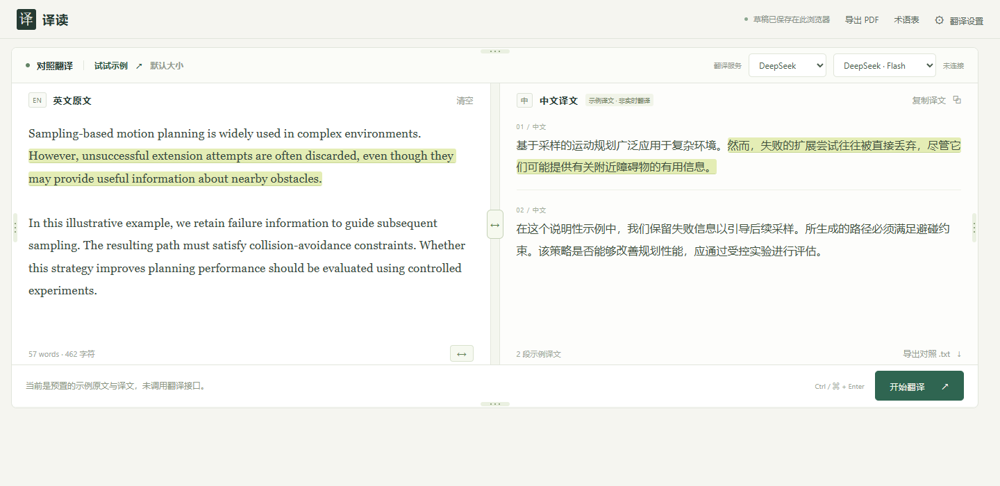

# 译读 · Paper Parallel Translator

在浏览器中输入英文，逐句对照中文译文。支持 OpenAI / DeepSeek、自定义术语、联动高亮和 PDF 导出。



> 截图使用项目自带的预置示例，没有调用翻译接口，也不包含真实论文、账号信息或 API Key。

## 功能

- **双栏输入与阅读**：左侧输入或粘贴英文，右侧逐段显示中文；译文可直接编辑。
- **逐句联动高亮**：悬停英文时，高亮对应中文；译文不在视野内时自动定位。
- **编辑后保留配对**：删除一句时保留其他句子的译文；新写或改写的句子标记为待翻译。
- **两套翻译服务**：分别配置 OpenAI 和 DeepSeek 的密钥、模型，按需切换。
- **模型发现**：读取当前 Key 对应服务返回的文本模型列表，也支持手动输入模型名。
- **术语表**：按 `英文 = 中文` 指定专业词汇，翻译时一并提交。
- **草稿保存**：原文、译文和布局保存在当前浏览器，刷新后可恢复。
- **灵活布局**：四条外边框可调整大小，中间分隔条调整左右比例；拖动顶部空白处移动整个工作区。
- **导出**：支持中文、英文、中英对照 PDF，以及中英对照 TXT。

## 快速开始

需要 **Node.js 22 或更新版本**。网站运行不依赖第三方 npm 包，无需执行 `npm install`。

```bash
git clone https://github.com/xmuzr/paper-parallel-translator.git
cd paper-parallel-translator
npm start
```

浏览器打开 **http://127.0.0.1:8765/**。也可以下载仓库 ZIP，解压后在项目目录执行 `node server.mjs`。

运行期间保持终端开启，按 `Ctrl+C` 停止服务。服务默认只监听本机地址。GitHub 仓库提供源码，使用时需要先启动这个本地后端。

推荐使用 Chrome 或 Edge；界面自动化检查基于 Windows / Edge。

## 配置翻译服务

### 在网页中配置

1. 打开右上角 **翻译设置**，选择 **OpenAI** 或 **DeepSeek**。
2. 输入该服务自己的 API Key。
3. 点击 **读取可用模型**，从完整下拉框中选择模型；也可选择末尾的手动填写入口。
4. 按需填写术语表，点击 **保存设置**。
5. 回到主界面，选择翻译服务和模型，输入英文后点击 **开始翻译**。

两个服务的密钥分开保存。切换服务不会覆盖另一个服务的配置，也不会自动重译现有内容。没有配置 Key 时，可以点击 **试试示例** 查看布局和联动高亮。

模型列表区分「常用预设」与「接口返回」。接口返回模型不等于该模型支持本站的全部翻译参数；实际可用性由账户权限、模型能力和服务状态决定。读取列表不会发送论文或发起翻译。

- OpenAI：[获取 API Key](https://platform.openai.com/api-keys) · [模型文档](https://developers.openai.com/api/docs/models)
- DeepSeek：[获取 API Key](https://platform.deepseek.com/api_keys) · [API 文档](https://api-docs.deepseek.com/zh-cn/)

翻译按所选服务的规则计费。若使用会员关联的 API 赠送额度，请以绑定 API 组织的实际余额为准：[OpenAI 官方说明](https://help.openai.com/en/articles/20001626-api-credits-benefit-for-eligible-chatgpt-subscriptions)。

### 使用本地环境文件

也可复制空白配置模板，在本机 `.env` 中填写需要的密钥，然后重启服务：

```powershell
Copy-Item .env.example .env
```

| 配置项 | 用途 / 默认值 |
| --- | --- |
| `OPENAI_API_KEY` | OpenAI 密钥，默认空白 |
| `OPENAI_MODEL` | OpenAI 默认模型：`gpt-5.4-mini` |
| `OPENAI_BASE_URL` | `https://api.openai.com/v1` |
| `DEEPSEEK_API_KEY` | DeepSeek 密钥，默认空白 |
| `DEEPSEEK_MODEL` | DeepSeek 默认模型：`deepseek-flash` |
| `DEEPSEEK_BASE_URL` | `https://api.deepseek.com` |
| `PORT` | 本地端口：`8765` |

环境变量优先于 `.env`。修改端口后，在浏览器中打开对应地址。**请勿把填写过密钥的 `.env` 上传到 GitHub。**

## 使用说明

- 英文段落之间留一个空行，可获得更清晰的逐段对照。
- `Ctrl+Enter` / `⌘+Enter` 开始翻译；停止后保留已经完成的译文。上游已处理的请求仍可能计费。
- 对已有逐句配对的内容，删除原文只移除对应配对；新增或改写内容标记为待翻译。再次点击翻译会请求全文。
- 四边的小手柄调整工作区边界；顶部栏空白处移动整个工作区；**默认大小**恢复初始布局。
- 右上角 **导出 PDF**选择中文、英文或中英对照，再在浏览器打印窗口选择 **另存为 PDF**。可关闭浏览器的页眉和页脚以去掉网页地址。
- 导出采用当前编辑后的文本。部分译文在对照版中标记未翻译位置；中文 PDF 只导出已有译文。

## 数据与密钥

| 数据 | 保存 / 发送位置 |
| --- | --- |
| 网页填写的 API Key | 本机 Node.js 服务的临时内存；不写入浏览器草稿或项目文件 |
| 本地 `.env` 中的 Key | 仅保存在用户自行创建的 `.env`；该文件已被 `.gitignore` 排除 |
| 原文、译文、术语表与布局 | 当前浏览器的 `localStorage`；清除浏览器站点数据会删除草稿 |
| 翻译请求 | 点击翻译后，正文和术语表发送至当前选中的服务，不自动回退到另一家 |
| 模型列表请求 | 仅向当前服务发送查询和认证信息，不发送论文正文 |
| PDF / TXT 导出 | 浏览器本地生成，不提交到额外的文档转换服务 |

临时密钥会话在 **12 小时后或服务重启后失效**；服务重启后需重新填写。配置接口只返回连接状态与模型信息，不返回密钥。保存设置不等于验证 Key 可用，实际请求才会由服务商校验。

代码与示例模板不包含项目所有者的 Key。其他人下载源码后，需要配置自己的密钥。

### 提交前检查

```bash
npm run check:secrets
# git add 之后、git commit 之前：
npm run check:staged
```

`.env*`（保留空白 `.env.example`）、认证文件、私钥、日志和测试生成的图片 / PDF 均被忽略。检查器只输出问题位置，不打印密钥值；暂存检查读取实际 Git 索引，并拦截已被纳入提交范围的敏感文件。

检查覆盖常见 API Key、GitHub Token、私钥和敏感文件名，不覆盖全部秘密格式、图片或提交历史，不能代替人工复核。手工 ZIP 或网页上传不会自动遵守 `.gitignore`。

如果密钥曾被提交或公开，应先在服务商后台撤销并换新，再处理历史记录：[GitHub 官方处理说明](https://docs.github.com/en/authentication/keeping-your-account-and-data-secure/removing-sensitive-data-from-a-repository)。

## 开发与验证

```bash
npm test
npm run check:secrets
```

单元与接口测试使用本地模拟上游，不需要真实 Key，不调用真实翻译服务。

`qa/` 中保留可选的浏览器检查脚本，需要单独准备 Playwright；Windows 下调用已安装的 Edge。例如：

```bash
node qa/browser-check.cjs
node qa/providers-check.cjs
node qa/model-picker-check.cjs
node qa/four-edges-check.cjs
```

这些开发检查依赖不影响网站本身的运行。

```text
public/          网页、样式、句子配对与高亮
server.mjs       本地 HTTP 服务、会话与翻译接口
scripts/         密钥检查工具
test/            Node.js 单元与接口测试
qa/              可选浏览器检查脚本
docs/images/     仅含演示内容的 README 截图
.env.example     空白环境配置模板
```

## 当前范围

- 输入上限 60,000 字符；超过 6,000 字符的单段会拆分处理。
- 翻译按段完成后显示，尚未实现 token 级流式输出。
- 数学公式、变量和引用编号按纯文本保留，尚未进行 LaTeX 渲染。
- 尚未包含 PDF 输入解析、Zotero 同步、用户账号、云端历史或跨稿件翻译缓存。
- 当前按本机工具设计；若要改为公网服务，需要另外实现 HTTPS、认证、用户隔离与额度控制。
- 模拟接口与页面验证不代表已验证每位用户的真实 Key、模型权限或翻译质量。专业表述和关键结论仍需对照原文核验。
